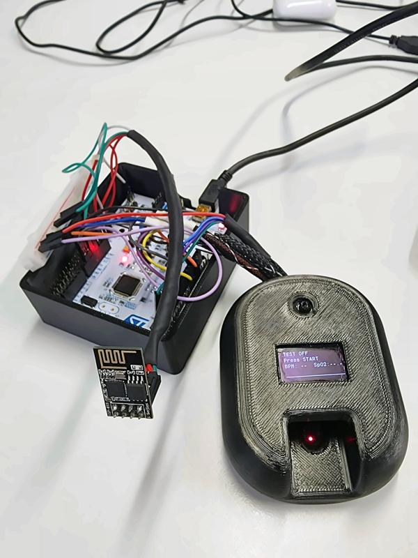
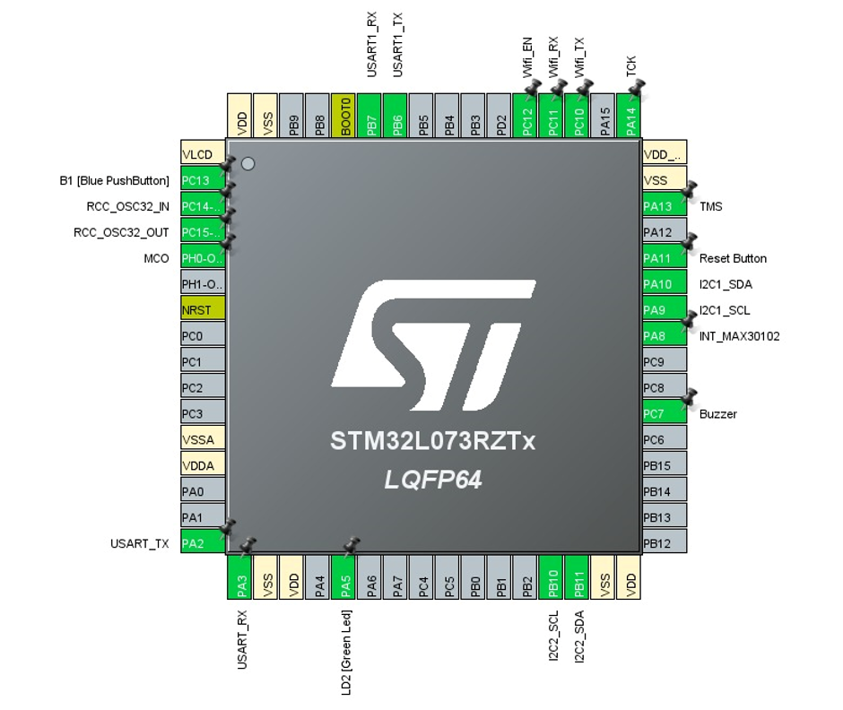

# Pulse and SpO2 Monitor on STM32

A heart-rate and SpO2 monitor on an STM32 NUCLEO-L073RZ. A button starts a 30-second measurement, and the results show up on an OLED screen.



Demo video: [youtube.com/watch?v=juPOlaFZyB8](https://www.youtube.com/watch?v=juPOlaFZyB8)

## Hardware

| Part | Role |
|---|---|
| NUCLEO-L073RZ (STM32L073RZ) | Main controller |
| MAX30102 | Red and IR optical pulse sensor, on I2C |
| SSD1306 OLED | Display, on I2C |
| ESP8266 | Wi-Fi link to Adafruit IO, on UART |
| Buzzer | Driven by PWM from TIM22 |



## How it works

The firmware is written in C in STM32CubeIDE, with the peripherals configured in STM32CubeMX.

The MAX30102 samples the red and IR signals at 100 samples per second, and its interrupt pin tells the MCU when new data is ready. A slow-moving baseline removes the DC component, and an integer IIR low-pass filter smooths the pulse.

Heartbeats are detected from valleys in the filtered signal using a dynamic threshold. The beat intervals are averaged for a stable BPM. SpO2 is calculated on every beat by comparing the pulse amplitude in the red and IR signals.

The buzzer beeps with each beat and plays the opening of Für Elise when a test starts and ends. At the end of a test, the average BPM and SpO2 are sent to an Adafruit IO dashboard through the ESP8266.

## Repository contents

| Path | Contents |
|---|---|
| `firmware/` | STM32CubeIDE project. The main logic is in `firmware/Core/Src/main.c` |
| `firmware/MAX_PulseSensor.ioc` | STM32CubeMX configuration |
| `images/` | Photo of the device and the pin configuration |

## Running it

Open the `firmware` folder as a project in STM32CubeIDE. Before building, set your Wi-Fi network and Adafruit IO credentials in `firmware/Core/Src/main.c`:

```c
#define WIFI_SSID     "YOUR_WIFI_SSID"
#define WIFI_PASS     "YOUR_WIFI_PASSWORD"
#define AIO_USERNAME  "YOUR_AIO_USERNAME"
#define AIO_KEY       "YOUR_AIO_KEY"
```

## Debug output

`printf` is redirected to USART2, which reaches the PC through the NUCLEO's ST-LINK virtual COM port. Open the port in PuTTY at 115200 baud, 8N1, to follow the Wi-Fi connection and the upload to Adafruit IO. More debug prints for the OLED, the sensor and the test flow are in `main.c`, commented out.

## Libraries

The OLED driver is [stm32-ssd1306](https://github.com/afiskon/stm32-ssd1306) by Olivier Van den Eede and Aleksander Alekseev.
The MAX30102 driver is [stm32-max30102](https://github.com/eepj/stm32-max30102) by eepj, under the MIT license.
